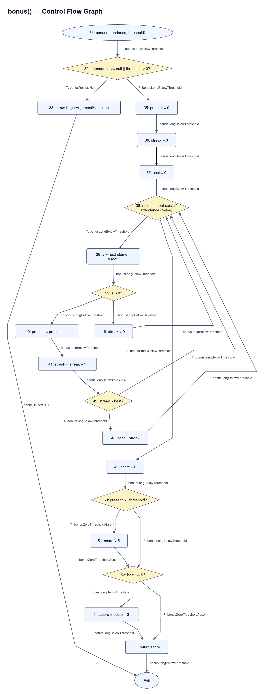

# Лаборатори №10 — Өгөгдлийн урсгалын тест — Definition-Use хосууд

- Хичээл: F.CSA313 — Программ хангамжийн чанарын баталгаа ба тест
- Оюутан: Л. Ирмүүн
- Оюутны код: B232270021
- Үйлдлийн систем: Ubuntu Linux
- IDE: Visual Studio Code

## Ажлын орчин

```text
=== java -version ===
openjdk version "21.0.12.1" 2026-08-18
OpenJDK Runtime Environment (build 21.0.12.1+1-1-24.04.4-Ubuntu)
OpenJDK 64-Bit Server VM (build 21.0.12.1+1-1-24.04.4-Ubuntu, mixed mode, sharing)

=== mvn -version ===
Apache Maven 3.8.7
Maven home: /usr/share/maven
Java version: 21.0.12.1, vendor: Ubuntu, runtime: /usr/lib/jvm/java-21-openjdk-amd64
Default locale: en_US, platform encoding: UTF-8
OS name: "linux", version: "7.0.0-42-generic", arch: "amd64", family: "unix"

=== locale charmap ===
UTF-8
```

Java 21 орчинд Java 17-д зориулж хөрвүүлэхийн тулд `pom.xml`-д
`maven-compiler-plugin` 3.13.0 хувилбарыг тодорхой заасан.

## Хэсэг A — gcd-ийн өгөгдлийн урсгалын анализ

### Definition ба use цэгүүд

| Мөр | Def | c-use | p-use |
|---|---|---|---|
| 13 | x, y | — | — |
| 15 | — | — | y |
| 16 | tmp | x, y | — |
| 17 | x | y | — |
| 18 | y | tmp | — |
| 20 | — | x | — |

14-р мөрийн `int tmp;` нь утга оноогоогүй зарлал.
`tmp`-ийн утгыг 16-р мөрөнд тодорхойлно.

### Тестүүд

| ID | Тестийн метод | Оролт | Хүлээх үр дүн |
|---|---|---|---:|
| G1 | `gcdWithZeroSecondArgumentReturnsFirstArgument` | (7, 0) | 7 |
| G2 | `gcdWithTwoIterationsCoversLoopCarriedPairs` | (12, 8) | 4 |

### DU хосууд

Def-clear зам нь тухайн хувьсагчийг дахин тодорхойлохгүйгээр
definition-оос use-д хүрэх зам юм.
Замд үндсэн гүйцэтгэгдэх мөрүүдийг тэмдэглэв.
`15T` болон `15F` нь while нөхцөлийн үнэн, худал ирмэгийг илэрхийлнэ.

| Хувьсагч | Def мөр | Use мөр | Төрөл | Def-clear зам | Тестийн ID | Хамрагдсан эсэх |
|---|---:|---:|---|---|---|---|
| x | 13 | 16 | c-use | 13 → 15T → 16 | G2 | Тийм |
| x | 13 | 20 | c-use | 13 → 15F → 20 | G1 | Тийм |
| x | 17 | 16 | c-use | 17 → 18 → 15T → 16 | G2 | Тийм |
| x | 17 | 20 | c-use | 17 → 18 → 15F → 20 | G2 | Тийм |
| y | 13 | 15 | p-use, T | 13 → 15T → 16 | G2 | Тийм |
| y | 13 | 15 | p-use, F | 13 → 15F → 20 | G1 | Тийм |
| y | 13 | 16 | c-use | 13 → 15T → 16 | G2 | Тийм |
| y | 13 | 17 | c-use | 13 → 15T → 16 → 17 | G2 | Тийм |
| y | 18 | 15 | p-use, T | 18 → 15T → 16 | G2 | Тийм |
| y | 18 | 15 | p-use, F | 18 → 15F → 20 | G2 | Тийм |
| y | 18 | 16 | c-use | 18 → 15T → 16 | G2 | Тийм |
| y | 18 | 17 | c-use | 18 → 15T → 16 → 17 | G2 | Тийм |
| tmp | 16 | 18 | c-use | 16 → 17 → 18 | G2 | Тийм |

p-use-ийн үнэн, худал ирмэгийг тусад нь бичсэн тул хүснэгт
13 мөртэй. Ирмэгийн ялгааг нэгтгэвэл хувьсагч, def мөр,
use мөрөөрөө ялгаатай 11 хос байна.

### Ажиглалт

G1 нь давталтад орохгүй тул анхны x-ийн 13 → 20 хос,
анхны y-ийн 15-р мөрийн худал ирмэгийг хамарна.
G2 нь хоёр давталт хийж, 17-р мөрөнд шинэчилсэн x,
18-р мөрөнд шинэчилсэн y-ийн дараагийн давталт дахь
хэрэглээг хамарна.
`tmp`-ийг 16-р мөрөнд тодорхойлоод 18-р мөрөнд ашиглах
хүртэл дахин тодорхойлохгүй тул энэ зам def-clear байна.

### Гүйцэтгэлийн үр дүн

`mvn verify` ажиллуулахад 2 тест бүгд амжилттай давсан:
Failures 0, Errors 0, Skipped 0; Maven exit code 0.
DU хамралтыг дээрх def-clear замууд болон G1, G2 тестийн
гүйцэтгэлтэй тулгаж баталгаажуулсан.

## Хэсэг B — bonus-ийн өгөгдлийн урсгалын анализ

### B1. Control Flow Graph



CFG-ийн зангилаануудыг `DataFlowTargets.java` файлын бодит
мөрийн дугаараар тэмдэглэсэн.
32-р мөрийн нийлмэл нөхцөлийг нэг шийдвэрийн зангилаагаар дүрслэв.
38-р мөрийн for-each давталтыг дараагийн элемент байгаа эсэхийг
шалгах нөхцөл, элементийг `a`-д оноох алхам болгон салгасан.

Ирмэгүүдэд бичсэн тестийн нэрс нь тестийн төлөвлөгөө бөгөөд
тестүүдийг хэрэгжүүлсний дараа гүйцэтгэлтэй тулгаж баталгаажуулна.

### B2. Definition болон use жагсаалт

| Мөр | Үйлдэл | Def | c-use | p-use |
|---|---|---|---|---|
| 31 | Параметр хүлээн авах | attendance, threshold | — | — |
| 32 | Оролт шалгах | — | — | attendance, threshold |
| 33 | Exception шидэх | — | — | — |
| 35 | `present = 0` | present | — | — |
| 36 | `streak = 0` | streak | — | — |
| 37 | `best = 0` | best | — | — |
| 38 | Массивын давталтыг эхлүүлэх | — | attendance | — |
| 38 | Дараагийн элемент байгаа эсэх | — | — | attendance |
| 38 | Дараагийн элементийг оноох | a | — | — |
| 39 | `a > 0` | — | — | a |
| 40 | `present = present + 1` | present | present | — |
| 41 | `streak = streak + 1` | streak | streak | — |
| 42 | `streak > best` | — | — | streak, best |
| 43 | `best = streak` | best | streak | — |
| 46 | `streak = 0` | streak | — | — |
| 49 | `score = 0` | score | — | — |
| 50 | `present >= threshold` | — | — | present, threshold |
| 51 | `score = 5` | score | — | — |
| 53 | `best >= 5` | — | — | best |
| 54 | `score = score + 3` | score | score | — |
| 56 | `return score` | — | score | — |

38-р мөрийн массивыг ашиглах c-use болон давталтын
нөхцөлийн p-use-ийг тусад нь тэмдэглэсэн.
32-р мөрөнд attendance null байвал short-circuit үнэлгээнээс
шалтгаалан threshold-ийн нөхцөлийг шалгахгүй.

40, 41, 54-р мөрүүдэд баруун талын хуучин утгыг эхлээд
ашиглаад, дараа нь зүүн талын хувьсагчид шинэ утга онооно.
Иймээс эдгээр мөр бүр def болон c-use хоёултай.
46-р мөрийн `streak = 0` нь түүнд хүрч ирсэн өмнөх
streak-ийн definition-ийг kill хийнэ.

### B3. DU хосууд ба def-clear замууд

#### Замын тэмдэглэгээ

- `38i`: for-each давталт эхлэхэд attendance массивыг ашиглах c-use.
- `38T`, `38F`: дараагийн элемент байгаа эсэхийн үнэн, худал ирмэг.
- `38a`: дараагийн элементийг a-д оноох def.
- `32A`: attendance == null нөхцөлийн use.
- `32B`: threshold < 0 нөхцөлийн use.
- Бусад `T`, `F` тэмдэглэгээ нь тухайн мөрийн нөхцөлийн үр дүн.

`38i`, `38T/F`, `38a` нь бүгд эх кодын 38-р мөрд хамаарна.
`32A`, `32B` нь эх кодын 32-р мөрийн short-circuit нөхцөлүүдийг
ялгаж тэмдэглэсэн бөгөөд CFG-д нэг шийдвэрийн зангилаагаар дүрслэгдсэн.

Дараах эхлэлийн замыг I гэж товчилсон:

I = 31 → 32F → 35 → 36 → 37 → 38i

Хүснэгтийн зам бүрд тухайн хувьсагчийн def-ээс use хүртэл
дахин definition тохиолдохгүй.

CFG-ийн ирмэгүүдэд тест файл дахь бодит методын нэрсийг
тэмдэглэсэн. Ирмэгүүдийн хамралтыг тестийн оролт,
гүйцэтгэлийн замуудтай тулгаж баталгаажуулсан.

#### attendance

| ID | Def мөр | Use мөр | Төрөл | Def-clear зам | Тестийн ID | Төлөв |
|---|---:|---:|---|---|---|---|
| A1 | 31 | 32 | p-use, attendance null: T | 31 → 32A(T) → 33 | B4 | Хамрагдсан |
| A2 | 31 | 32 | p-use, attendance null: F | 31 → 32A(F) → 32B | B1 | Хамрагдсан |
| A3 | 31 | 38 | c-use | I | B1 | Хамрагдсан |
| A4 | 31 | 38 | p-use, T | I → 38T → 38a | B1 | Хамрагдсан |
| A5 | 31 | 38 | p-use, F | I → 38F → 49 | B3 | Хамрагдсан |

attendance параметрт дахин утга оноохгүй тул дээрх замуудад
түүний 31-р мөрийн definition kill болохгүй.

#### threshold

| ID | Def мөр | Use мөр | Төрөл | Def-clear зам | Тестийн ID | Төлөв |
|---|---:|---:|---|---|---|---|
| T1 | 31 | 32 | p-use, threshold < 0: T | 31 → 32A(F) → 32B(T) → 33 | B5 | Хамрагдсан |
| T2 | 31 | 32 | p-use, threshold < 0: F | 31 → 32A(F) → 32B(F) → 35 | B1 | Хамрагдсан |
| T3 | 31 | 50 | p-use, T | I → 38T → 38a → 39F → 46 → 38F → 49 → 50T → 51 | B2 | Хамрагдсан |
| T4 | 31 | 50 | p-use, F | I → 38F → 49 → 50F → 53 | B3 | Хамрагдсан |

attendance null үед short-circuit үнэлгээнээс шалтгаалан
threshold-ийн 32-р мөрийн use ажиллахгүй.
Гэхдээ дээрх дөрвөн DU шаардлага тус бүр биелэх оролттой.

#### a

| ID | Def мөр | Use мөр | Төрөл | Def-clear зам | Тестийн ID | Төлөв |
|---|---:|---:|---|---|---|---|
| V1 | 38 | 39 | p-use, T | 38a → 39T → 40 | B1 | Хамрагдсан |
| V2 | 38 | 39 | p-use, F | 38a → 39F → 46 | B2 | Хамрагдсан |

a-д давталт бүрд шинэ утга онооно.
39-р мөр тухайн давталтын 38a definition-ийг ашиглана.

#### present

| ID | Def мөр | Use мөр | Төрөл | Def-clear зам | Тестийн ID | Төлөв |
|---|---:|---:|---|---|---|---|
| P1 | 35 | 40 | c-use | 35 → 36 → 37 → 38i → 38T → 38a → 39T → 40 | B1 | Хамрагдсан |
| P2 | 40 | 40 | c-use | 40 → 41 → 42T → 43 → 38T → 38a → 39T → 40 | B1 | Хамрагдсан |
| P3 | 35 | 50 | p-use, T | 35 → 36 → 37 → 38i → 38T → 38a → 39F → 46 → 38F → 49 → 50T → 51 | B2 | Хамрагдсан |
| P4 | 35 | 50 | p-use, F | 35 → 36 → 37 → 38i → 38F → 49 → 50F → 53 | B3 | Хамрагдсан |
| P5 | 40 | 50 | p-use, T | 40 → 41 → 42T → 43 → 38F → 49 → 50T → 51 | B6 | Хамрагдсан |
| P6 | 40 | 50 | p-use, F | 40 → 41 → 42F → 38F → 49 → 50F → 53 | B1 | Хамрагдсан |

P2 нь 40-р мөрийн шинэ утгыг дараагийн давталтын
40-р мөрийн баруун талд ашиглах хос юм.
P3-д present анхны 0 утгатай, threshold мөн 0 тул нөхцөл үнэн болно.

#### streak

| ID | Def мөр | Use мөр | Төрөл | Def-clear зам | Тестийн ID | Төлөв |
|---|---:|---:|---|---|---|---|
| S1 | 36 | 41 | c-use | 36 → 37 → 38i → 38T → 38a → 39T → 40 → 41 | B1 | Хамрагдсан |
| S2 | 41 | 41 | c-use | 41 → 42T → 43 → 38T → 38a → 39T → 40 → 41 | B1 | Хамрагдсан |
| S3 | 46 | 41 | c-use | 46 → 38T → 38a → 39T → 40 → 41 | B1 | Хамрагдсан |
| S4 | 41 | 42 | p-use, T | 41 → 42T → 43 | B1 | Хамрагдсан |
| S5 | 41 | 42 | p-use, F | 41 → 42F → 38 | B1 | Хамрагдсан |
| S6 | 41 | 43 | c-use | 41 → 42T → 43 | B1 | Хамрагдсан |

B1-ийн эхний таван ирц best-ийг 5 болгоно.
Тасалсан өдрийн дараа streak 0 болж, дараагийн ирцэд 1 болно.
Ингэснээр 46 → 41 хос болон 42-р мөрийн худал ирмэг хамрагдана.

#### best

| ID | Def мөр | Use мөр | Төрөл | Def-clear зам | Тестийн ID | Төлөв |
|---|---:|---:|---|---|---|---|
| Bst1 | 37 | 42 | p-use, T | 37 → 38i → 38T → 38a → 39T → 40 → 41 → 42T → 43 | B1 | Хамрагдсан |
| Bst2 | 37 | 53 | p-use, F | 37 → 38i → 38F → 49 → 50F → 53F → 56 | B3 | Хамрагдсан |
| Bst3 | 43 | 42 | p-use, T | 43 → 38T → 38a → 39T → 40 → 41 → 42T → 43 | B1 | Хамрагдсан |
| Bst4 | 43 | 42 | p-use, F | 43 → 38T → 38a → 39F → 46 → 38T → 38a → 39T → 40 → 41 → 42F → 38 | B1 | Хамрагдсан |
| Bst5 | 43 | 53 | p-use, T | 43 → 38T → 38a → 39F → 46 → 38T → 38a → 39T → 40 → 41 → 42F → 38F → 49 → 50F → 53T → 54 | B1 | Хамрагдсан |
| Bst6 | 43 | 53 | p-use, F | 43 → 38F → 49 → 50T → 51 → 53F → 56 | B6 | Хамрагдсан |

Bst4 болон Bst5-ийн замд streak өөрчлөгдөж байгаа боловч
best дахин тодорхойлогдохгүй тул best-ийн хувьд def-clear хэвээр.

#### score

| ID | Def мөр | Use мөр | Төрөл | Def-clear зам | Тестийн ID | Төлөв |
|---|---:|---:|---|---|---|---|
| Sc1 | 49 | 54 | c-use | 49 → 50F → 53T → 54 | B1 | Хамрагдсан |
| Sc2 | 49 | 56 | c-use | 49 → 50F → 53F → 56 | B3 | Хамрагдсан |
| Sc3 | 51 | 54 | c-use | 51 → 53T → 54 | B7 | Хамрагдсан |
| Sc4 | 51 | 56 | c-use | 51 → 53F → 56 | B2 | Хамрагдсан |
| Sc5 | 54 | 56 | c-use | 54 → 56 | B1 | Хамрагдсан |

54-р мөрийн баруун тал хуучин score-ийг ашиглаад,
тооцооллын үр дүнг шинэ definition болгон онооно.
54-р мөрийн шинэ definition-ийг 56-р мөр ашиглана.

#### Kill ба def-clear биш замууд

- 40-р мөрийн оноолт нь өмнөх present-ийн definition-ийг kill хийнэ.
  Харин тухайн мөрийн баруун тал хуучин definition-ийг эхлээд ашиглана.
- 41-р мөрийн оноолт нь өмнөх streak-ийн definition-ийг kill хийнэ.
- 46-р мөрийн `streak = 0` нь түүнд хүрч ирсэн 36, 41 эсвэл
  өмнөх давталтын 46-р мөрийн streak definition-ийг kill хийнэ.
- 43-р мөр best-ийн өмнөх definition-ийг kill хийнэ.
- 51 болон 54-р мөрүүд score-ийн өмнөх definition-ийг kill хийнэ.

| Хослол буюу зам | DU шаардлагад хэрхэн хандах | Үндэслэл |
|---|---|---|
| streak: 36 → 42 | DU хос биш | 42-д хүрэхийн өмнө 41-р мөр streak-ийг заавал дахин тодорхойлно. |
| streak: 36 → 43 | DU хос биш | 43-д хүрэхийн өмнө 41-р мөр анхны definition-ийг kill хийнэ. |
| streak: 46 → 42 | DU хос биш | Дараагийн ирцийн үед 41-р мөр streak-ийг дахин тодорхойлсны дараа 42 ажиллана. |
| streak: 46 → 43 | DU хос биш | 43-д хүрэх замд 41-р мөр заавал ажиллаж, 46-р мөрийн definition-ийг kill хийнэ. |
| streak: 41 → 46 → 41 | Энэ зам def-clear биш | Дундах 46-р мөр өмнөх 41-ийн definition-ийг kill хийнэ; дараагийн 41 нь 46-ийн утгыг ашиглана. |
| present: 35 → 40 → 50 | Энэ зам 35 → 50 хосыг хамрахгүй | 40-р мөр 35-ийн definition-ийг kill хийнэ; 50 нь 40-ийн утгыг ашиглана. |
| best: 37 → 43 → 53 | Энэ зам 37 → 53 хосыг хамрахгүй | 43-р мөр анхны best-ийн definition-ийг kill хийнэ. |
| score: 49 → 51 → 56 | Энэ зам 49 → 56 хосыг хамрахгүй | 51-р мөр 49-ийн definition-ийг kill хийнэ. |
| score: 51 → 54 → 56 | Энэ зам 51 → 56 хосыг хамрахгүй | 54-ийн баруун тал 51-ийн утгыг ашигласан ч шинэ оноолтын дараа 56 нь 54-ийн definition-ийг ашиглана. |

Def-clear биш нэг зам байгаа нь тухайн def–use хос бүхэлдээ
биелэшгүй гэсэн үг биш. Жишээлбэл score-ийн 49 → 56 хос
50F → 53F замаар биелнэ.

#### Биелэшгүй p-use салаанууд

| Хувьсагч | Def | Use | Биелэшгүй салаа | Үндэслэл |
|---|---:|---:|---|---|
| best | 37 | 42 | F | best анхны 0 утгатай хэвээр үед 42-д анх хүрвэл streak 1 болсон байна; 1 > 0 үнэн тул худал салаа авахгүй. |
| best | 37 | 53 | T | 37-р мөрийн definition хэвээр бол best 0 байна; 0 >= 5 худал тул үнэн салаа авахгүй. |

Эдгээр биелэшгүй салааг хамруулах тест шаардахгүй.
Бусад хүснэгтэд орсон шаардлагуудад биелэх оролт төлөвлөсөн.

### B4. All-defs тестүүд

All-defs хангахад bonus функцийн хоёр тест сонгосон.

| ID | Тестийн метод | Оролт | Хүлээх үр дүн |
|---|---|---|---:|
| B1 | `bonusLongBelowThreshold` | [1,1,1,1,1,0,1], threshold=8 | 3 |
| B2 | `bonusZeroThresholdAbsent` | [0], threshold=0 | 5 |

B1-д present=6, best=5 болно. Threshold хүрээгүй тул
51-р мөрийг алгасаж, 49-р мөрийн score=0 утгыг
54-р мөрөнд ашиглаад 3 буцаана.
Тасалсан өдрийн дараа дахин ирсэн тул 46-р мөрийн
streak definition дараагийн 41-р мөрд ашиглагдана.

B2-д present=0, best=0 байна. Threshold=0 учраас
51-р мөрийн score=5 definition 56-р мөрийн return-д хүрнэ.

Нэг дуудлагад 51-р мөр ажиллавал 49-р мөрийн score definition
ямар нэг use-д хүрэхээс өмнө kill болно.
51-р мөрийг алгасвал түүний definition үүсэхгүй.
Иймээс эдгээр хоёр definition-ийг use-д хүргэхэд хамгийн багадаа
хоёр дуудлага шаардлагатай.
Тест бүр нэг дуудлагатай бөгөөд сонгосон хоёр тест
бусад definition-уудыг мөн use-д хүргэж байгаа тул хангалттай.

Нотолгоо:

- [All-defs үеийн Maven гаралт](results/mvn-verify-alldefs.txt)
- [All-defs үеийн JaCoCo хэмжилт](results/jacoco-alldefs.csv)

#### All-defs үеийн бодит хэмжилт

`mvn clean verify` ажиллуулахад GcdTest-ийн 2,
BonusTest-ийн 2 буюу нийт 4 тест бүгд давсан.
Failures 0, Errors 0, Skipped 0; Maven exit code 0.

| Хэмжүүр | Хамрагдсан | Хамрагдаагүй | Хамралт |
|---|---:|---:|---:|
| Branch | 14 | 2 | 87.50% |
| Line | 22 | 2 | 91.67% |

Branch хамралт: 14 / (2 + 14) × 100 = 87.50%.
Line хамралт: 22 / (2 + 22) × 100 ≈ 91.67%.

All-defs хангагдсан боловч null оролт болон сөрөг threshold-ийн
exception замууд хамрагдаагүй тул Branch хамралт 100% болоогүй.
Хамрагдаагүй мөрүүд нь 7-р мөрийн далд constructor,
33-р мөрийн exception юм.
Иймээс all-defs хангах нь бүх салаа болон бүх DU хос
хамрагдсаны баталгаа биш.

### All-DU-pairs хүртэл өргөжүүлсэн нь

All-defs-ийн хоёр тест дээр null оролт болон сөрөг threshold-ийн
хоёр exception тест нэмэхэд нийт 6 тест давж, Branch хамралт
16/16 буюу 100% болсон.
Гэвч энэ үед score-ийн 49 → 56, 51 → 54 зэрэг DU хосууд
хамрагдаагүй хэвээр байсан.

Жишээлбэл B1 нь 53-р мөрийн үнэн салааг 49-р мөрийн score
definition-тэйгээр дамжина.
B2 нь 51-р мөрөнд score-ийг тодорхойлох боловч 53-р мөрийн
худал салааг авч, 54-р мөрийг алгасна.
Иймээс хоёр салаа хамрагдсан ч score-ийн 51 → 54 хос
хамрагдаагүй байна.

B3, B6, B7 тестүүдийг нэмснээр үлдсэн биелэх DU шаардлагуудыг
хамарсан. Нийт 9 тест бүгд давж, Maven exit code 0 гарсан.
Branch хамралт 100% хэвээр байсан боловч DU хүснэгтийн
өмнө дутуу байсан хосууд нэмэгдэж хамрагдсан.

Энэ ажиглалт нь Branch 100% гэдэг нь all-DU-pairs
хангагдсаны баталгаа биш болохыг харуулна.
DU хамралтыг JaCoCo-оор бус, def-clear зам болон
тестийн оролттой тулгасан хүснэгтээр баталгаажуулсан.

#### All-DU-pairs үеийн хэмжилт

Нийт 9 тест бүгд амжилттай давсан:
Failures 0, Errors 0, Skipped 0; Maven exit code 0.

| Хэмжүүр | Хамрагдсан | Хамрагдаагүй | Хамралт |
|---|---:|---:|---:|
| Branch | 16 | 0 | 100% |
| Line | 23 | 1 | 95.83% |

Line хамралт: 23 / (1 + 23) × 100 ≈ 95.83%.
Хамрагдаагүй мөр нь 7-р мөрийн далд constructor юм.
DU хамралтыг JaCoCo хэмжилтээс тусад нь,
DU хүснэгтийн def-clear замуудыг тестүүдтэй тулгаж баталгаажуулсан.